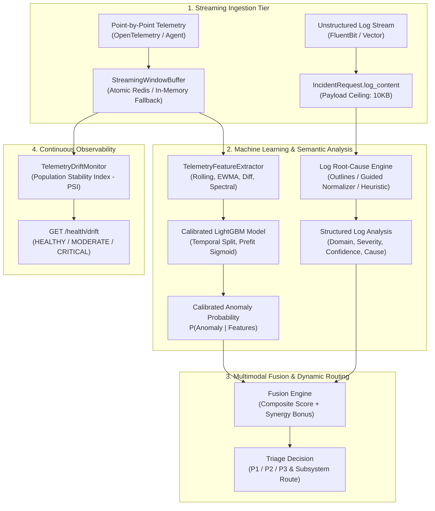

# Real-Time IT Incident Triage Engine: Architecture & System Manual

## 1. Executive Summary & Problem Formulation

In modern distributed cloud-native infrastructures, Mean Time to Detect (MTTD) and Mean Time to Acknowledge (MTTA) are the primary determinants of customer-facing downtime and SLA penalties. Traditional Site Reliability Engineering (SRE) workflows suffer from a fundamental architectural flaw: **monitoring silos**.

```
+-----------------------------------+        +-----------------------------------+
|      Metric Monitoring Silo       |        |        Log Aggregation Silo       |
|    (Prometheus, Datadog, M3DB)    |        |    (Elasticsearch, Splunk, Loki)  |
+-----------------+-----------------+        +-----------------+-----------------+
                  |                                            |
                  v                                            v
         Threshold Breaches                           Error Log Floods
         (e.g., CPU > 85%)                         (e.g., Socket Exceptions)
                  |                                            |
                  +---------------------+----------------------+
                                        |
                                        v
                       +---------------------------------+
                       |     On-Call Engineer Fatigue    |
                       | - 20-40 min manual correlation  |
                       | - Dashboard context switching   |
                       | - Ambiguous routing / escalation|
                       +---------------------------------+
```

- **Metric-only monitoring** alerts on numerical threshold breaches but lacks causal context. A CPU spike may represent a routine cron job or a fatal thread-lock.
- **Log-only monitoring** alerts on keywords (`ERROR`, `FATAL`, `Exception`) but lacks system degradation context. A transient timeout in an isolated retry loop may trigger false-positive alert storms.

The **Real-Time IT Incident Triage Engine** solves this by implementing an online, multimodal signal-fusion architecture. It ingests continuous time-series metrics and discrete semi-structured logs simultaneously, computes calibrated statistical anomaly risks and semantic severity scores, fuses them into a unified incident probability, assigns a concrete operational priority (`P1`, `P2`, `P3`), and routes the ticket to the exact on-call subsystem in sub-100 millisecond latency.



---

## 2. Telemetry Anomaly Detection & Statistical Rigor

### 2.1 The Streaming Time-Series Problem
Telemetry data arrives as a sequence of observations $x_t \in \mathbb{R}$ at regular sampling intervals $\Delta t$ (e.g., 5-minute AWS EC2 CPU utilization intervals from the Numenta Anomaly Benchmark).

### 2.2 Feature Engineering Pipeline
The feature extraction layer (`incident_triage/telemetry.py`) transforms a raw window of values $[x_{t-W+1}, \dots, x_t]$ into a dense feature vector $\mathbf{f}_t \in \mathbb{R}^D$:

1. **Statistical Rolling Moments**:
   $$\mu_k(t) = \frac{1}{k} \sum_{i=0}^{k-1} x_{t-i}, \quad \sigma_k(t) = \sqrt{\frac{1}{k} \sum_{i=0}^{k-1} (x_{t-i} - \mu_k(t))^2} \quad \text{for } k \in \{3, 5, 12\}$$
2. **Exponentially Weighted Moving Averages (EWMA)**:
   $$\text{EWMA}_\alpha(t) = \alpha x_t + (1 - \alpha) \text{EWMA}_\alpha(t-1) \quad \text{for } \alpha \in \{0.1, 0.3\}$$
3. **Differential Dynamics**:
   $$\Delta x_t = x_t - x_{t-1}, \quad \Delta^2 x_t = \Delta x_t - \Delta x_{t-1}$$
4. **Spectral & Rolling Extremities**:
   $$\text{Spread}_k(t) = \max_{0 \le i < k}(x_{t-i}) - \min_{0 \le i < k}(x_{t-i})$$

### 2.3 Elimination of Temporal Data Leakage (3-Way Split)
In time-series anomaly detection, applying random K-Fold cross-validation or fitting probability calibrators on training data causes severe optimistic evaluation bias. The model memorizes future regime changes and evaluates thresholds on seen distributions.

```
+-----------------------------------------------------------------------------------------+
|                                Full Historical Time Series                              |
+------------------------------------+--------------------------+-------------------------+
|         Train Window (60%)         |    Tune & Calib (20%)    |    Test Holdout (20%)   |
|         [0 -> 0.6 * N]             |    [0.6 * N -> 0.8 * N]  |    [0.8 * N -> N]       |
+------------------------------------+--------------------------+-------------------------+
| - Fit Base LightGBM Estimator      | - Fit Sigmoid Calibrator | - Pure Holdout Metrics  |
| - Learn Tree Split Thresholds      |   (cv="prefit")          | - Unbiased Precision,   |
|                                    | - Optimize F1 Threshold  |   Recall, and ROC-AUC   |
+------------------------------------+--------------------------+-------------------------+
```

### 2.4 Probability Calibration & Threshold Optimization
Raw decision-tree margins (such as those output by LightGBM or Random Forests) do not reflect true posterior probabilities $P(Y=1 \mid \mathbf{x})$. To enable mathematical signal fusion downstream, raw margins are calibrated into true probabilities via **Platt Scaling (Sigmoid Method)**:

$$P(Y=1 \mid f) = \frac{1}{1 + \exp(A \cdot f + B)}$$

Parameters $A$ and $B$ are estimated on the independent tuning partition using maximum likelihood estimation (`cv="prefit"`).

The optimal classification threshold $t^*$ is selected over a search grid $T \in [0.05, 0.95]$ on the tuning partition to maximize the $F_1$ score:

$$t^* = \arg\max_{t \in T} \frac{2 \cdot \text{Precision}(t) \cdot \text{Recall}(t)}{\text{Precision}(t) + \text{Recall}(t)}$$

#### Empirical Generalization Metrics (`artifacts/tabular_metrics.json`):
- **Training Samples**: 10,830 rows
- **Tuning Samples**: 3,610 rows
- **Test Holdout Samples**: 3,610 rows
- **Optimal Decision Threshold ($t^*$)**: $0.050$
- **Holdout Test Set Performance**:
  - Class 0 (Normal): Precision = $82.78\%$, Recall = $100.0\%$, $F_1 = 0.906$
  - Class 1 (Anomaly): Precision = $100.0\%$, Recall = $21.87\%$, $F_1 = 0.359$
  - Overall Weighted Accuracy: $83.57\%$

---

## 3. Log Root-Cause Extraction & SLM Distillation

### 3.1 Log Semantic Parsing
Unstructured text lines from distributed logs (e.g., Apache Hadoop HDFS) contain rich contextual indicators that explain the underlying nature of an outage.

```text
2026-11-19 20:20:01 INFO org.apache.hadoop.hdfs.server.datanode.DataNode: 
PacketResponder 2 for block blk_902318412891 terminating due to socket exception
```

### 3.2 Teacher-Student Knowledge Distillation Architecture
Rather than training a Small Language Model (SLM) on rigid, rule-based regular expressions (which creates an upper-bound circular reasoning trap), the architecture provides a pluggable distillation pipeline (`incident_triage/train_slm.py`):

```
+-----------------------------------+
|     Historical Incident Logs      |
+-----------------+-----------------+
                  |
                  v
+-----------------------------------+
|      Weak Supervision Filter      | ---> Discards benign heartbeats / INFO logs
+-----------------+-----------------+
                  | Candidate Anomalies
                  v
+-----------------------------------+
|    Teacher Model (Gemini / GPT)   | ---> Generates rich, contextual root-cause
+-----------------+-----------------+      explanations & domain classifications
                  | Validated JSON Labels
                  v
+-----------------------------------+
|  Student SLM (SmolLM 135M / LoRA) | ---> Fine-tuned via PEFT (q_proj, v_proj, r=8)
+-----------------------------------+
```

### 3.3 3-Tier Reliability Shield (Zero 500 API Crashes)
Language models in production can output truncated JSON, conversational filler, or unmapped severity keys under heavy load. To prevent API downtime, `generate_structured_log_analysis` implements a three-tier execution hierarchy:

```
                      Log Analysis Request
                               |
                               v
             +----------------------------------+
             | Level 1: Logit-Masked Guided     |
             | Generation (Outlines / vLLM)     |
             +-----------------+----------------+
                               |
                [Fails / Engine Not Present]
                               |
                               v
             +----------------------------------+
             | Level 2: Strict Normalization &  |
             | Schema Auto-Repair Engine        |
             +-----------------+----------------+
                               |
                    [Malformed / Unparseable]
                               |
                               v
             +----------------------------------+
             | Level 3: Deterministic Heuristic |
             | Domain Fallback (Zero Failures)  |
             +-----------------+----------------+
                               |
                               v
                 Guaranteed Valid LogAnalysis
```

---

## 4. Multimodal Signal Fusion & Routing Engine

### 4.1 Fusion Formulation
The fusion layer (`incident_triage/fusion.py`) calculates a unified scalar Incident Score $S \in [0.0, 1.0]$:

$$S = \text{clamp}\left( w_{\text{telem}} \cdot R_{\text{telem}} + w_{\text{log}} \cdot (\text{SeverityScore} \times \text{Confidence}) + \text{Bonus}_{\text{synergy}} \right)$$

- **Default Configuration**: $w_{\text{telem}} = 0.55$, $w_{\text{log}} = 0.45$.
- **Severity Mapping**:
  $$\text{SeverityScore}(\text{level}) = \begin{cases} 
  1.00 & \text{CRITICAL / FATAL} \\
  0.80 & \text{HIGH / ERROR} \\
  0.50 & \text{MEDIUM / WARN} \\
  0.25 & \text{INFO} \\
  0.15 & \text{LOW / DEBUG} 
  \end{cases}$$
- **Synergy Bonus Dynamic**:
  $$\text{Bonus}_{\text{synergy}} = \begin{cases} 
  0.08 & \text{if } R_{\text{telem}} > 0.75 \text{ and } (\text{SeverityScore} \times \text{Confidence}) > 0.75 \\
  0.05 & \text{if log severity is CRITICAL and bonus not already applied} \\
  0.00 & \text{otherwise}
  \end{cases}$$

### 4.2 Priority Assignment & Subsystem Routing Matrix

| Incident Score ($S$) | Operational Priority | Target Subsystem / Escalation Path | Operational Response |
| :---: | :---: | :---: | :--- |
| **$S \ge 0.70$** | **P1** | `incident-bridge` | Immediate automated page to Incident Commander, opens war room. |
| **$0.40 \le S < 0.70$** | **P2** | Subsystem specific: <br> • `NameSystem` $\to$ `hdfs-platform` <br> • `DataNode` $\to$ `storage-oncall` <br> • Other $\to$ `general-oncall` | 15-minute SLA ticket dispatched directly to component on-call team. |
| **$S < 0.40$** | **P3** | `general-oncall` | Low-priority work queue; logged for daily batch inspection. |

---

## 5. Distributed Streaming & State Store

### 5.1 The Horizontal Scaling Problem
In modern production environments running multi-worker ASGI (`uvicorn --workers 4`) or multi-pod Kubernetes clusters, requests from a single server or container (`asset_id`) are distributed across different processes via round-robin load balancers. In-memory data structures fragment the sliding window.

### 5.2 Dual-Backend Streaming Architecture (`incident_triage/stream_buffer.py`)
The engine implements `StreamBufferProtocol` via a factory pattern:

```
                                  Incoming Streaming Metric
                                  {value: 74.2, asset_id: "host-1"}
                                                |
                                                v
                                  +---------------------------+
                                  |   create_stream_buffer()  |
                                  +-------------+-------------+
                                                |
                       +------------------------+------------------------+
                       |                                                 |
                       v                                                 v
           [REDIS_URL is configured]                         [Local Dev / Single Worker]
                       |                                                 |
                       v                                                 v
        +-----------------------------+                   +-----------------------------+
        |    RedisStreamingBuffer     |                   |   InMemoryStreamingBuffer   |
        | - Atomic LPUSH + LTRIM      |                   | - collections.deque         |
        | - Shared across all workers |                   | - threading.Lock() thread-safe|
        | - Zero cache fragmentation  |                   | - Zero external dependencies|
        +-----------------------------+                   +-----------------------------+
```

#### Redis Sliding Window Operation:
```python
# Atomic Pipeline execution:
pipe = client.pipeline()
pipe.lpush(f"telemetry:{entity_id}", value)
pipe.ltrim(f"telemetry:{entity_id}", 0, maxlen - 1)
pipe.lrange(f"telemetry:{entity_id}", 0, maxlen - 1)
_, _, raw_values = pipe.execute()
```

---

## 6. Population Stability Index (PSI) & Drift Monitoring

### 6.1 Mathematical Formulation of Concept Drift
When underlying cloud infrastructure changes (e.g., instance resizing, new software releases, traffic volume shifts), the baseline distribution of telemetry metrics shifts, causing model decay.

The **Population Stability Index (PSI)** measures the statistical divergence between the baseline reference distribution $P_{\text{base}}$ and the observed production distribution $P_{\text{live}}$ across $B$ bins:

$$\text{PSI} = \sum_{b=1}^{B} \left( P_{\text{live}}(b) - P_{\text{base}}(b) \right) \times \ln\left( \frac{P_{\text{live}}(b)}{P_{\text{base}}(b)} \right)$$

To ensure numerical stability when comparing discrete or small-sample continuous distributions, Laplace smoothing ($\lambda = 1.0$) is applied to all frequency bins.

### 6.2 Operational Interpretation & Alerting Rules

```
     PSI < 0.10               0.10 <= PSI < 0.25                 PSI >= 0.25
+---------------------+     +---------------------+     +---------------------+
|       HEALTHY       |     |   MODERATE_DRIFT    |     |   CRITICAL_DRIFT    |
+---------------------+     +---------------------+     +---------------------+
| No significant shift|     | Mild distribution   |     | Severe concept drift|
| Model outputs are   |     | variance detected.  |     | Detected. Automated |
| statistically stable|     | Warn ML team.       |     | retrain required.   |
+---------------------+     +---------------------+     +---------------------+
```

The health check endpoint `GET /health/drift` exposes live drift status directly to Prometheus and Grafana for automated alerting.

---

## 7. Security, API Specifications & Production Runbook

### 7.1 Security Architecture
- **Header Authentication**: Enforced via `X-API-Key`.
  - When `API_KEY` is present in the environment, unauthorized requests receive `401 Unauthorized`.
  - When `API_KEY` is not configured (local development / automated unit tests), authentication is transparently bypassed.
  - `/health`, `/health/drift`, `/docs`, and `/openapi.json` remain unauthenticated for Kubernetes liveness/readiness probes.
- **Denial of Service (DoS) Defense**: `IncidentRequest.log_content` enforces a strict 10KB payload limit (`max_length=10,000`). Excessive payloads are rejected at the edge with `422 Unprocessable Entity` before memory or CPU resources are consumed.

### 7.2 REST API Reference

#### `POST /api/v1/triage`
Executes real-time incident triage. Accepts either single streaming data points or historical batches.

##### Headers:
- `Content-Type: application/json`
- `X-API-Key: <your-api-key>` *(if API_KEY is set in environment)*

##### Request Body (Streaming Single-Point Example):
```json
{
  "telemetry": {
    "value": 82.5,
    "metric_name": "cpu_utilization"
  },
  "asset_id": "prod-k8s-worker-node-14",
  "log_content": "PacketResponder 2 for block blk_902318412891 terminating due to socket exception"
}
```

##### Response Body (200 OK):
```json
{
  "incident_score": 0.93,
  "priority": "P1",
  "route_to": "incident-bridge",
  "explanation": "Telemetry risk 0.89, log severity CRITICAL with confidence 1.00 produced fused score 0.93.",
  "telemetry": {
    "risk_score": 0.89,
    "threshold": 0.05,
    "is_anomaly": true,
    "probability": 0.89,
    "feature_snapshot": {
      "rolling_mean_5": 81.2,
      "ewma_0.1": 79.4,
      "diff_1": 3.1
    }
  },
  "log_analysis": {
    "error_domain": "HDFS_DataNode",
    "severity": "CRITICAL",
    "probable_cause": "Packet responder termination, timeout, or storage subsystem failure",
    "confidence": 1.0,
    "raw_text": "PacketResponder 2 for block blk_902318412891 terminating due to socket exception"
  }
}
```

---

#### `GET /health`
Returns system status, active ML artifact state, and the active state-buffer backend.

##### Response Body (200 OK):
```json
{
  "status": "ok",
  "telemetry_model": "loaded",
  "buffer_backend": "RedisStreamingBuffer"
}
```

---

#### `GET /health/drift`
Returns statistical concept drift telemetry for the live metric stream.

##### Response Body (200 OK):
```json
{
  "status": "HEALTHY",
  "psi": 0.0384,
  "drift_detected": false,
  "sample_count": 30
}
```

---

### 7.3 Production Container Runbook

#### Building the Container:
```bash
docker build -t incident-triage:v1.0.0 .
```

#### Running in Production:
```bash
docker run -d \
  --name incident-triage \
  -p 8000:8000 \
  -e API_KEY="prod-sec-key-891238" \
  -e REDIS_URL="redis://prod-redis-cluster.internal:6379/0" \
  incident-triage:v1.0.0
```

#### Kubernetes Deployment Manifest:
```yaml
apiVersion: apps/v1
kind: Deployment
metadata:
  name: incident-triage-engine
  labels:
    app: incident-triage
spec:
  replicas: 4
  selector:
    matchLabels:
      app: incident-triage
  template:
    metadata:
      labels:
        app: incident-triage
    spec:
      containers:
      - name: engine
        image: incident-triage:v1.0.0
        ports:
        - containerPort: 8000
        env:
        - name: API_KEY
          valueFrom:
            secretKeyRef:
              name: triage-secrets
              key: api-key
        - name: REDIS_URL
          value: "redis://redis-service.default.svc.cluster.local:6379/0"
        resources:
          requests:
            cpu: "500m"
            memory: "1Gi"
          limits:
            cpu: "2000m"
            memory: "4Gi"
        livenessProbe:
          httpGet:
            path: /health
            port: 8000
          initialDelaySeconds: 10
          periodSeconds: 15
        readinessProbe:
          httpGet:
            path: /health
            port: 8000
          initialDelaySeconds: 5
          periodSeconds: 10
```
